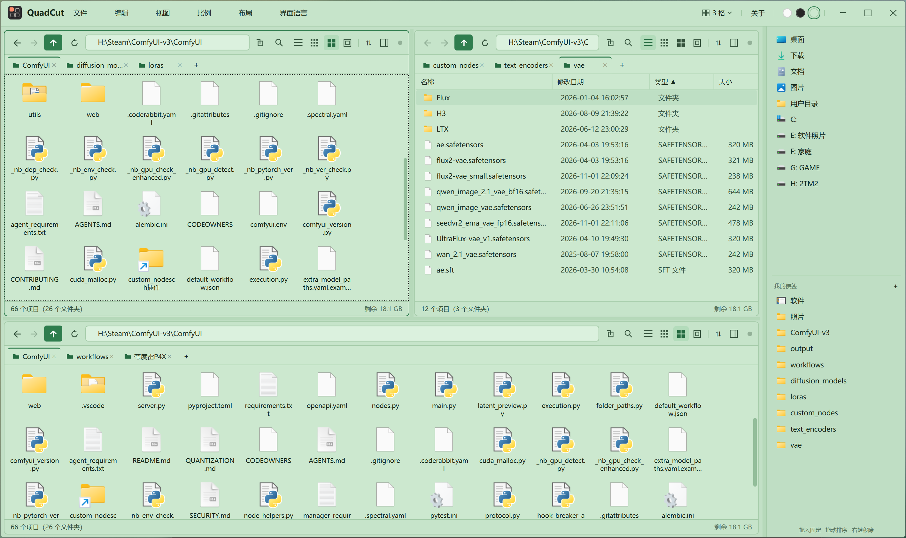
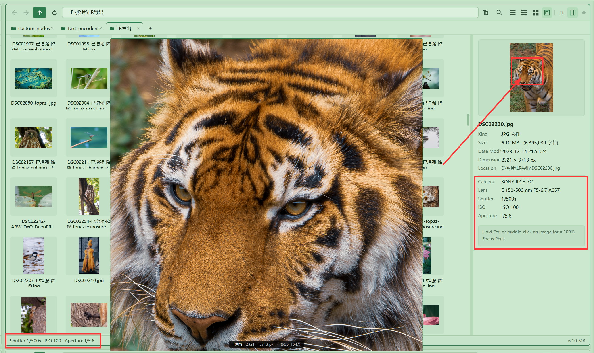
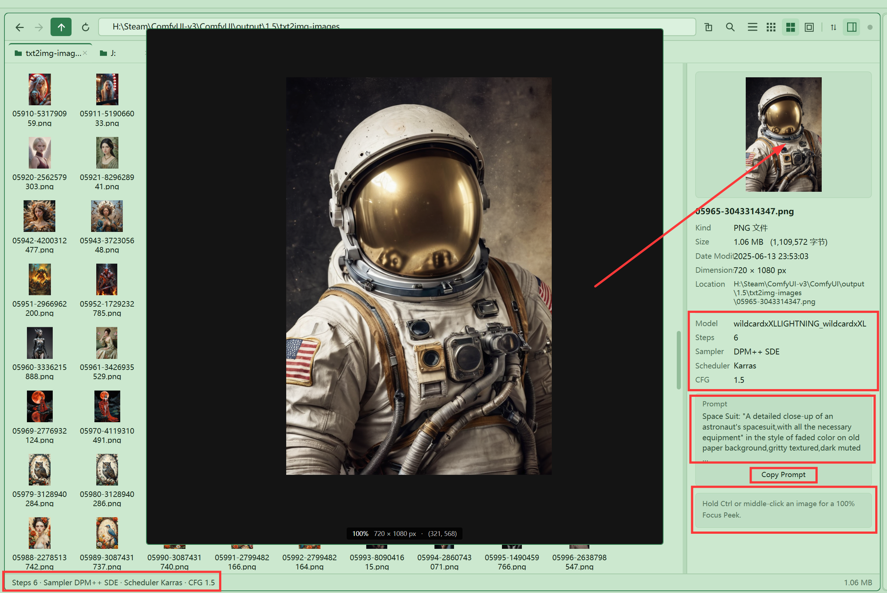
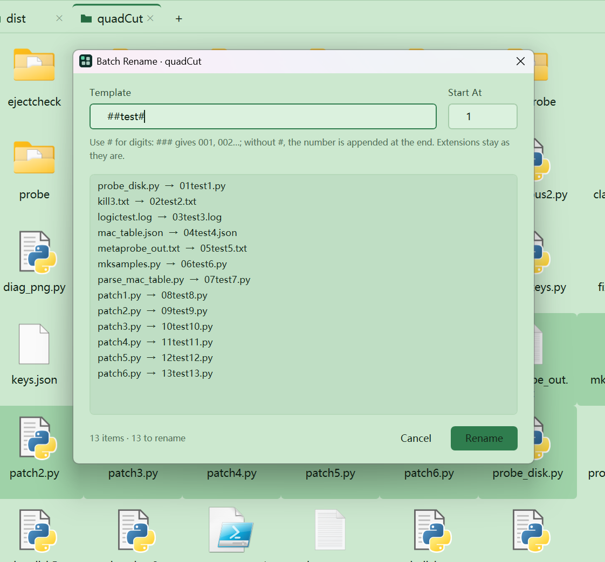
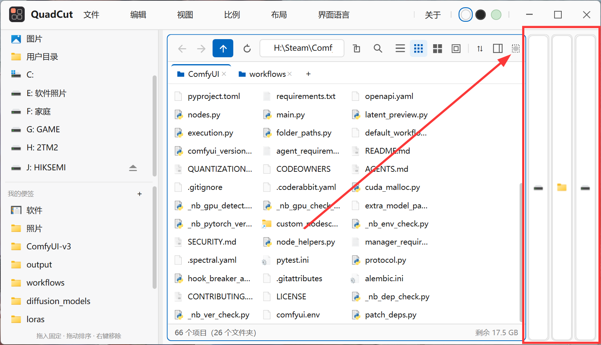
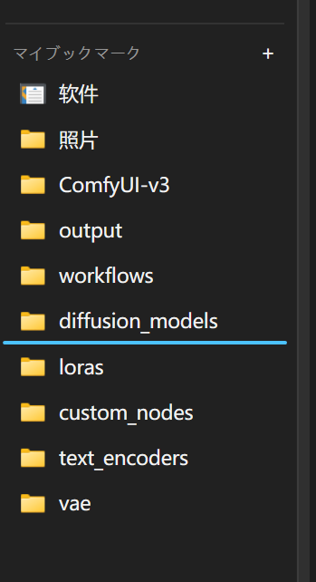
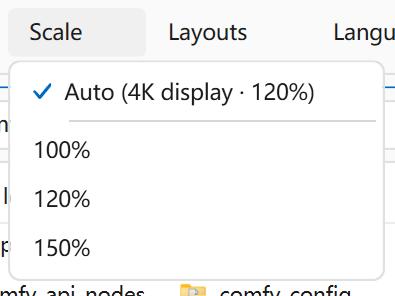
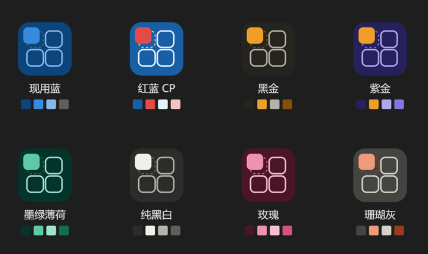
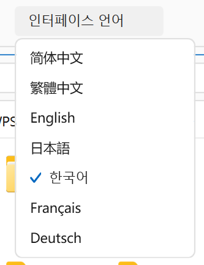

  <a href="README.md">简体中文</a> ·
  <a href="README.zh-Hant.md">繁體中文</a> ·
  <a href="README.en.md">English</a> ·
  <a href="README.ja.md">日本語</a> ·
  <a href="README.ko.md">한국어</a> ·
  <a href="README.fr.md">Français</a> ·
  <a href="README.de.md"><b>Deutsch</b></a>

  

<strong style="color:#D4AF37; font-size:22px; letter-spacing:2px;">In Anerkennung von Q-Dir</strong>

<h1 align="center">QuadCut</h1>

<strong>Dateimanager mit vier Bereichen · Windows 1.8.3</strong>

Wer schon einmal Fotos mit dem Windows-Explorer sortiert hat, kennt das Hin und Her: im einen Fenster kopieren, im anderen einfügen, und nach ein paar Minuten weiß man nicht mehr, welches welches war. Aus Dutzenden Serienbildern das eine scharfe herauszusuchen heißt, jedes einzelne doppelzuklicken, zu vergrößern und wieder zu schließen.

QuadCut legt das alles auf einen Bildschirm: vier Bereiche gleichzeitig offen, links auswählen, rechts ablegen; bis zu 6 Tabs pro Bereich; und eine gehaltene Taste zeigt jedes Detail in 100 %. Es ist auch ein Dateimanager, der mit Fotos und KI-Bildern umgehen kann – eine Datei auswählen und schon stehen Verschlusszeit, ISO und Blende da, samt Modell und Prompt bei KI-Bildern.

---

## Vier Bereiche, ein Bildschirm

Vier, drei oder zwei Bereiche, jederzeit umschaltbar, und jeder Bereich kann mehrere Tabs halten. Links auswählen, rechts ablegen: `Ctrl+X` / `Ctrl+V` zwischen den Bereichen verschiebt die Dateien, ohne dass man zwischen zwei Explorer-Fenstern hin und her springt. Tabs lassen sich per Ziehen umsortieren, in einen anderen Bereich ziehen oder in die Seitenleiste ziehen, wo sie zu Lesezeichen werden.

## Farbvarianten gegen müde Augen

Den ganzen Tag auf dasselbe blasse Grau zu starren, ermüdet am meisten. Drei Paletten – hell, dunkel und augenschonendes Grün – lassen sich dem Licht des Tages und der Stimmung anpassen, sodass stundenlanges Aussortieren und Aufräumen weniger anstrengt. Der Wechsel wirkt sofort und bleibt nach einem Neustart erhalten.

## Schärfe prüfen: Strg für 100 %

Die Schärfe von 30 Serienbildern prüfen? Kein Grund zum Verzweifeln. `Ctrl` über der Vorschau halten und das Bild erscheint sofort in 100 % der echten Pixel; ein Klick mit der mittleren Taste heftet es fest, sodass es nach dem Loslassen bleibt. Direkter lässt sich kaum beurteilen, ob ein Bild scharf ist.

Ohne einen Viewer zu öffnen: Eine Foto auswählen, rechts stehen Abmessungen, Kameragehäuse und Objektiv, und die Statusleiste nennt Verschlusszeit, ISO und Blende. RAW wird unterstützt; Sortieren nach Aufnahmezeit, nur Bilder anzeigen und JPEGs direkt drehen (nur Markierungen, keine Neukomprimierung) finden sich im Menü.

## KI-Daten auf einen Blick

Für die Parameter eines KI-Bildes muss die KI-Software nicht starten: Modell, Sampler, Schritte, CFG und positiver Prompt, die ComfyUI und A1111 / SD.Next in die PNG-Datei schreiben, erscheinen beim Auswählen, daneben eine Schaltfläche zum Kopieren des Ganzen. „Wie war dieses Bild noch mal entstanden?“ ist in einer Sekunde beantwortet; selbst ein reiner Upscale-Workflow verrät, welches Upscaler-Modell zum Einsatz kam.

---

## Stapelweises Umbenennen

Ein paar Dateien auswählen und `F2` drücken, `werk###` als Vorlage eintragen und man erhält `werk001`, `werk002`… Das Ergebnis wird vorher angezeigt, geändert wird erst nach dem Bestätigen. Entweder gelingt alles, oder nichts wird angefasst.

## Mit einem Klick vergrößern

Plötzlich volle Konzentration auf einen einzigen Ordner nötig? Ein Klick auf Vergrößern und der Platz ist da. Jeder Bereich trägt einen sehr dezenten kleinen Punkt in der oberen rechten Ecke: ein Klick und dieser Bereich füllt die gesamte Arbeitsfläche, die anderen schrumpfen zu schmalen Streifen, in denen nur ein Symbol bleibt; erneut auf den Punkt oder auf einen beliebigen Streifen klicken und alles kehrt genau in den Zustand von vorher zurück. Wenn man sich durch einen Ordner unter vielen gräbt, ohne das Layout zu ändern und ohne sich zu merken, wohin man zuletzt gezogen hat.

## Lesezeichen nach Bedarf

Häufig genutzte Orte in der Seitenleiste anheften und mit einem Klick erreichen; unnötige (Musik, Videos, ein bestimmtes Laufwerk) per Rechtsklick ausblenden und mit einem einzigen „Alle anzeigen“ zurückholen – ausgeblendet wird nur in der Seitenleiste, nie ein Ordner auf der Festplatte. Die ganze Leiste lässt sich zudem an die rechte Fensterseite verschieben, samt Breite, Lesezeichen und ausgeblendeten Einträgen.

## UI-Skalierung passend zum Monitor

Neuer Monitor, geänderte Skalierung, Beamer angeschlossen – kein Suchen in den Einstellungen: Das standardmäßige „Automatisch“ berechnet das passende Verhältnis für den aktuellen Bildschirm, und feste Stufen von 100 % / 120 % / 150 % stehen bereit, wenn man das lieber mag. Text und Symbole bleiben scharf und werden nie so klein, dass man die Augen zusammenkneifen muss.

---

## Logo nach Lust und Laune

Das gleiche Logo leid? Wechseln Sie es nach Stimmung – vom frischen Guanlan-Blau und reinem Schwarzweiß bis zu Rot-Blau, Schwarz-Gold, Violett-Gold und Rosé. Acht Farbschemata, und geändert wird das Programmsymbol, zusammen mit Titelleiste und Taskleiste.

## Sieben Sprachen

简体中文, 繁體中文, English, 日本語, 한국어, Français, Deutsch. Beim ersten Start wird die Systemsprache übernommen, danach lässt sich jederzeit im Menü wechseln.

## Und sonst noch praktisch

- **Lesezeichen und Rechtsklick-Zustellung**: Rechtsklick auf einen Ort oder ein Lesezeichen → „Im Bereich öffnen“ und oben links / unten rechts wählen, ohne Ziehen
- **Suche** (`Ctrl+F`): der aktuelle Ordner samt Unterordnern, mit den Platzhaltern `*` `?`
- **Direktsprung per Buchstabe**: die ersten Buchstaben tippen und die Liste springt zur Datei
- **Die Adressleiste ist auch eine Ausführen-Zeile**: `cmd` oder `notepad` eintippen und es startet; eine Verknüpfung auf einen Ordner öffnet sich per Doppelklick im Bereich
- **Ein Blick in Dokumente**: TXT (auch GBK), die erste PDF-Seite, eingebettete Vorschauen von PPTX / Word – ohne Office zu starten
- **Aktualisierung bei Rückkehr**: anderswo kopierte Dateien sind beim Zurückkommen schon da, ein `F5` gespart; nach dem Löschen setzen die Pfeiltasten dort fort, statt nach oben zu springen
- **Wechselmedien auswerfen**: eine Auswerfen-Schaltfläche direkt neben USB-Sticks und externen Festplatten, kein Suchen im Infobereich
- **Nur eine Instanz**: erneutes Starten holt das offene Fenster nach vorn, statt ein weiteres zu öffnen

---

## Download (1.8.3)

| Variante | Größe | Empfohlenes System |
| --- | --- | --- |
| `quadCut.exe` (vollständig) | ca. 70 MB | Windows 7 und neuer, keine Runtime nötig |
| `quadCut-portable.zip` (vollständig) | ca. 68 MB | Ebenso, einfach entpacken und starten |
| `quadCut-lite.zip` (schlank) | ca. 7,6 MB | Windows 10 und neuer (.NET 6+ Desktop-Runtime erforderlich) |

Direkter Download: [vollständige quadCut.exe](https://github.com/dungeonlee/QuadCut-win/releases/latest/download/quadCut.exe) · [Portable-ZIP](https://github.com/dungeonlee/QuadCut-win/releases/latest/download/quadCut-portable.zip) · [schlanke ZIP](https://github.com/dungeonlee/QuadCut-win/releases/latest/download/quadCut-lite.zip)
Zeigt Windows beim ersten Start „Windows hat Ihren PC geschützt“, auf „Weitere Informationen → Trotzdem ausführen“ klicken.

---

## Lizenz

Copyright © 2026 Michael. Alle Rechte vorbehalten.

Kostenlose Nutzung, einschließlich Demonstrationen und alltäglicher Nutzung in kommerziellen Projekten.

Kostenlose Weitergabe unverändert erlaubt, jedoch nicht gegen Entgelt und nicht als verkaufsfähiges Produkt.

Veränderung, Dekompilierung und Reverse Engineering sind untersagt, ebenso die Weitergabe veränderter Versionen.

Bereitgestellt „wie besehen“, ohne Gewähr; für Schäden aus der Nutzung haftet der Autor nicht.

Vollständiger Text in der LICENSE der Anwendung (`LICENSE` / `LICENSE.txt` im Veröffentlichungspaket).

---

## Andere Plattform

**macOS-Version** → https://github.com/dungeonlee/QuadCut

Windows-Projektseite → https://github.com/dungeonlee/QuadCut-win
